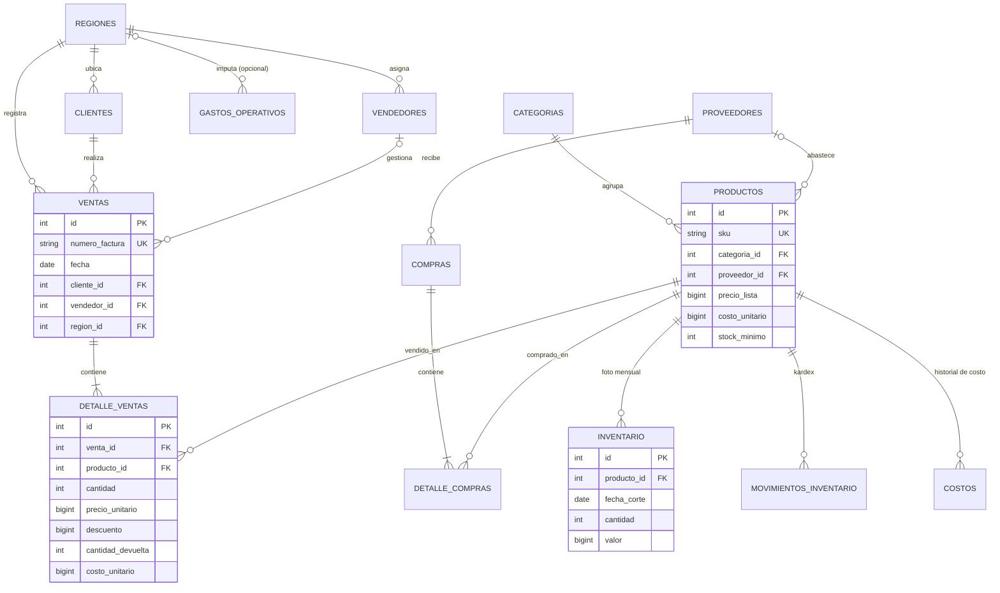

# Modelo entidad-relación

Modelo relacional en SQLite definido con SQLAlchemy (`src/database/models.py`). DDL completo:
`sql/schema.sql`. Detalle de columnas: `docs/diccionario_datos.md`.

## Decisiones de diseño

| Decisión | Motivo |
|---|---|
| Importes en **BIGINT (COP enteros)** | El peso colombiano no usa centavos en la operación; enteros eliminan errores de redondeo de punto flotante. Los ratios se calculan en la capa analítica. |
| `costo_unitario` copiado en `detalle_ventas` | Foto del costo vigente en la fecha de venta: el margen histórico no cambia si el costo del producto se actualiza después. |
| Tabla `costos` con vigencias | Permite analizar la evolución de costos y detectar incrementos (regla de alertas). |
| `inventario` como foto de fin de mes + `movimientos_inventario` (kardex) | Las fotos permiten calcular inventario promedio y rotación sin reprocesar el kardex; el kardex permite auditar (control de calidad: saldo kardex = última foto). |
| `cantidad` con signo en el kardex | Suma directa del saldo; restricción `cantidad <> 0`. |
| Encabezado/detalle en ventas y compras | Modelo transaccional estándar; el ticket se calcula por factura. |
| Columna `origen` | Trazabilidad: `DEMO` o `IMPORTACION:<archivo>`. |
| `region_id` opcional en gastos | Hay gastos corporativos que no pertenecen a una región. |
| Restricciones CHECK | Cantidades positivas, descuentos ≤ valor bruto, devoluciones ≤ cantidad, montos ≥ 0, estados válidos. |
| `PRAGMA foreign_keys=ON` en cada conexión | SQLite no aplica llaves foráneas por defecto. |
| Índices | Fechas de ventas/compras/gastos, cliente+fecha, región, vendedor, producto+fecha en kardex, fecha de corte. |
